<picture>
  <source media="(prefers-color-scheme: light)" srcset="docs/banner-light.png">
  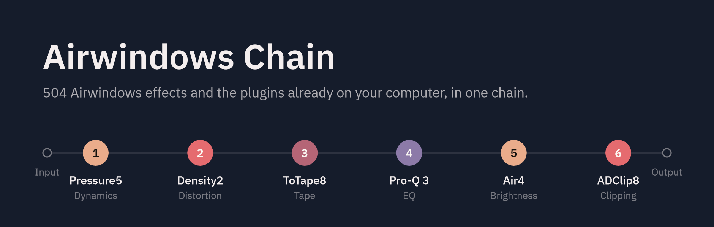
</picture>

<p align="center">
  <a href="https://github.com/clotheshoesandwoes/airwindows-chain/releases/latest"></a>
  <a href="https://github.com/clotheshoesandwoes/airwindows-chain/releases"></a>
  
  <a href="LICENSE"></a>
</p>

<p align="center">
  <a href="https://github.com/clotheshoesandwoes/airwindows-chain/releases/latest"><b>Download for Windows</b></a>
  &nbsp;&nbsp;&nbsp; <a href="https://seankani.com/airwindows-chain/">Website</a>
  &nbsp;&nbsp;&nbsp; <a href="#using-it">Using it</a>
  &nbsp;&nbsp;&nbsp; <a href="#build-it-yourself">Build it yourself</a>
</p>

<br>

<p align="center">
  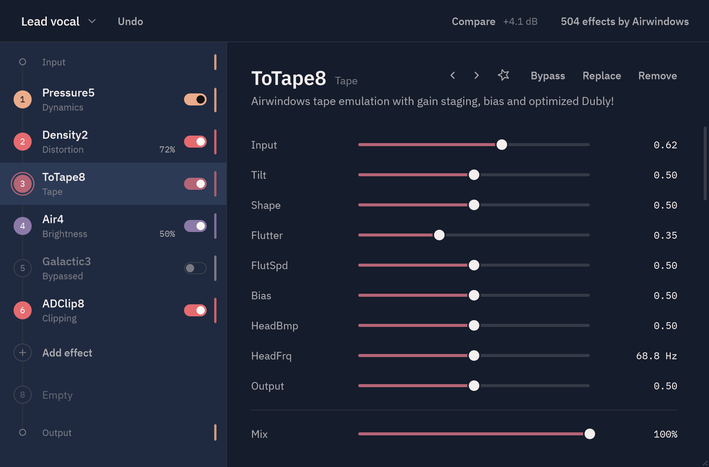
</p>

<p align="center">
  Up to sixteen Airwindows effects in one plugin, in any order,<br>
  with Chris Johnson's own notes next to every control.<br>
  The VST3 plugins already on your computer go in the same chain.
</p>

<br>

## What it does

- **One chain, one window.** Eight slots ready, sixteen if you need them. Drag to reorder, bypass or blend each effect, and watch the level after every one. Undo covers all of it.
- **Every Airwindows effect, with the notes.** All 504 effects from [Airwindows Consolidated](https://www.airwindows.com/consolidated/), unchanged. The browser has Chris's recommended list, every category, search, favourites, and his Airwindopedia write-up for whatever you are on.
- **Your own plugins too.** Any VST3 on the computer goes in the chain next to the Airwindows effects: a FabFilter EQ between tape and air, an Arturia compressor first. Each one is read by a separate helper program, so a plugin that crashes or hangs while it's being scanned is skipped instead of taking your DAW down.
- **Compare, at the same loudness.** One click plays the original instead of the chain, turned up or down to match it, so you hear what the chain does to the sound and not just that it's louder.
- **Projects that travel.** Open a project on a computer that lacks one of its plugins and that slot stays, named and with its settings, until the plugin is there again.
- **Nothing touches the audio code.** The chain is tested against the effects run on their own: the output matches, bit for bit, with every one of the 504 run through a slot.

<br>

<p align="center">
  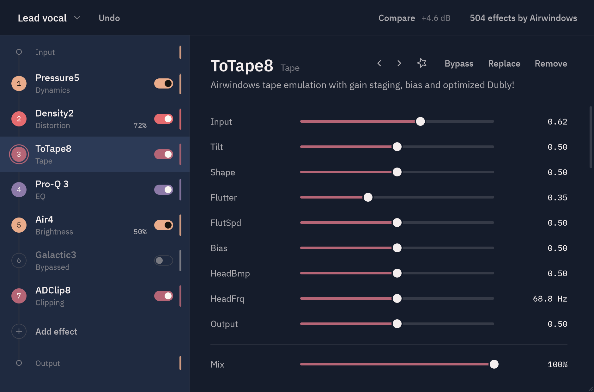
</p>
<p align="center"><sub>A lead vocal chain. Slot four is FabFilter Pro-Q 3, from the same computer.</sub></p>

<br>

## Your plugins in the chain

"Your VST3 plugins" in the browser lists every VST3 effect installed on the computer. The first time you open it, the plugin folders are scanned once and remembered; "Scan again" picks up anything new.

Pick one and the side panel shows what it is, every control it has, and the manual its maker installed with it. Click the manual to open it in your PDF viewer.

<p align="center">
  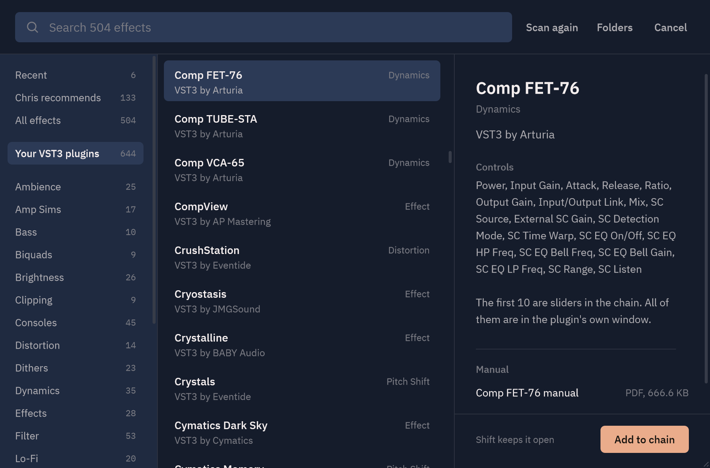
</p>
<p align="center"><sub>Arturia's Comp FET-76: its controls, read from the plugin, and the manual Arturia installed with it.</sub></p>

<br>

In the chain, a plugin's first ten controls become sliders like any Airwindows effect's, so your DAW can automate them. "Open plugin window" opens the plugin's own interface for everything else. Turn a knob there and the slider follows.

<p align="center">
  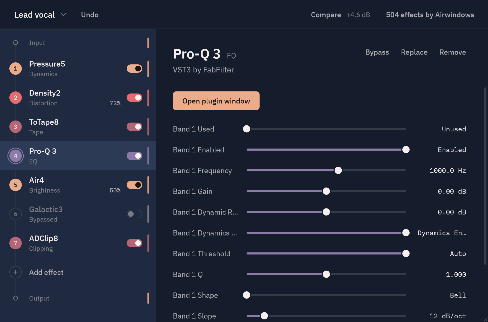
</p>
<p align="center"><sub>Pro-Q 3 in the chain. Its first ten controls are sliders; the rest are in its own window.</sub></p>

<br>

- **Scanning.** Each plugin file is read by a small helper program in its own process. If a plugin crashes, or is still stuck after 90 seconds (a licence prompt nobody answers, say), the helper is closed and that plugin skipped. Stop really stops, mid-plugin.
- **Folders.** The standard VST3 folder is always scanned. Add as many of your own as you keep plugins in, from "Folders" in the browser; each can be removed again.
- **Skipped plugins** are listed under Folders, so a missing one can be explained. "Scan again" gives them another go.
- **Latency.** Plugins that delay the sound (linear-phase EQs, lookahead limiters) are compensated: the dry signal is held back to match, your DAW is told the total, and it is kept right when the plugin changes it or you bypass it.

<br>

## Compare

Most effects make things a little louder, and louder sounds better. Compare takes that out of the decision.

The number next to it is how much louder the chain is than what comes in, measured the way a LUFS meter measures it, over the last three seconds. Click Compare and you hear the original, raised or lowered by exactly that much, in time with the chain. Click again to go back. Nothing about the chain changes while you listen.

<p align="center">
  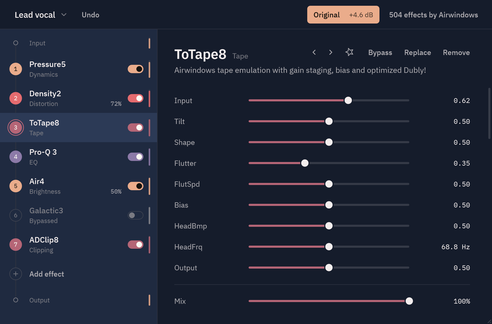
</p>
<p align="center"><sub>Compare on. The chain is 4.6 dB louder, so the original plays 4.6 dB up.</sub></p>

<br>

## The browser

<table>
  <tr>
    <td width="50%">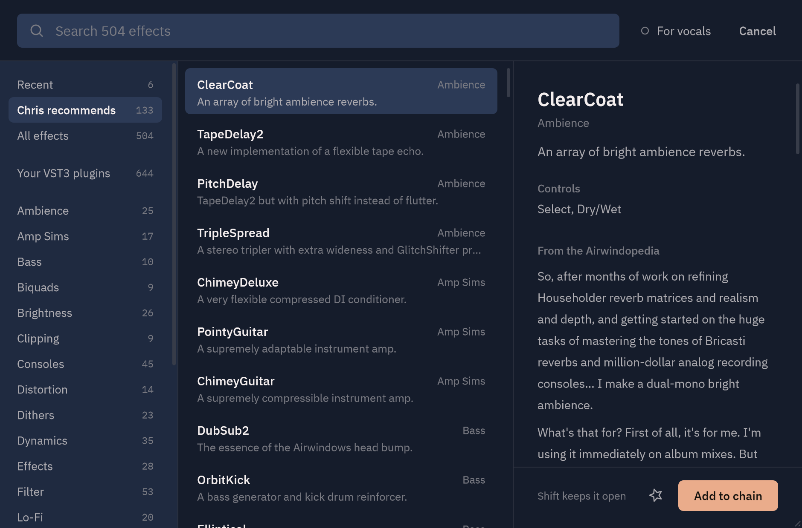</td>
    <td width="50%">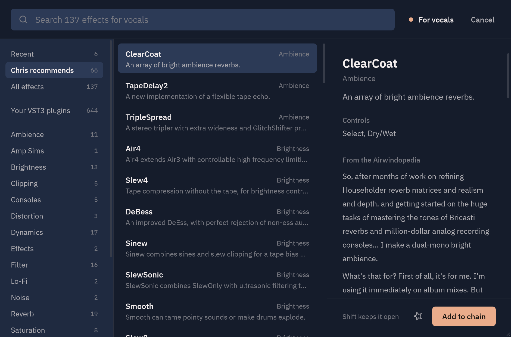</td>
  </tr>
  <tr>
    <td align="center"><sub>Chris recommends, every category, and the write-up for whatever you are on.</sub></td>
    <td align="center"><sub>For vocals: the same lists, narrowed to what suits a voice.</sub></td>
  </tr>
  <tr>
    <td>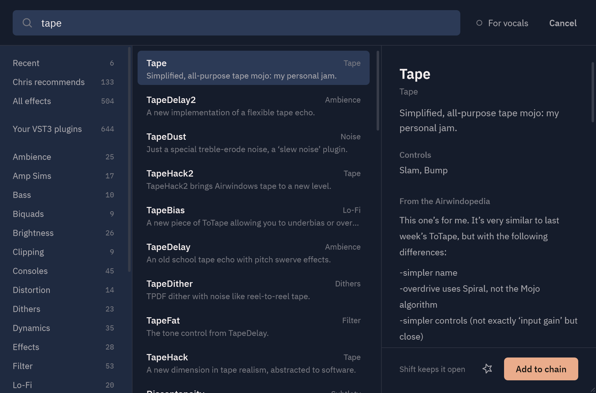</td>
    <td>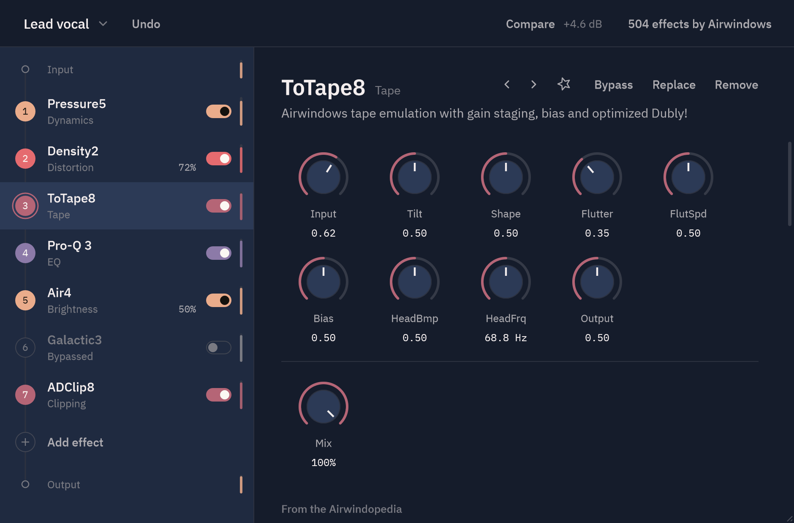</td>
  </tr>
  <tr>
    <td align="center"><sub>Typing "tape" from the main window.</sub></td>
    <td align="center"><sub>Knobs instead of faders, if you prefer them.</sub></td>
  </tr>
</table>

<br>

## Projects that travel

A chain that names a plugin this computer doesn't have keeps the slot. It shows the plugin's name, passes sound through untouched, and is saved again exactly as it came, settings and all. Install the plugin and it comes back. The same plugin installed in a different folder is recognised as the same plugin.

<p align="center">
  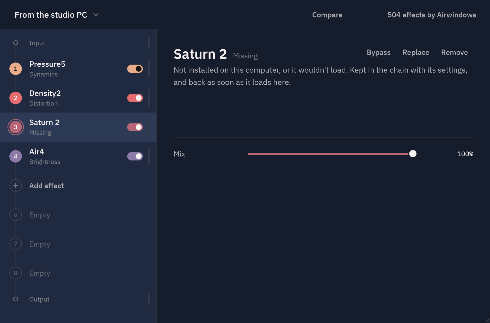
</p>
<p align="center"><sub>A chain from another computer. Saturn 2 isn't installed here, so it waits in its slot.</sub></p>

<br>

## Looks

<p align="center">
  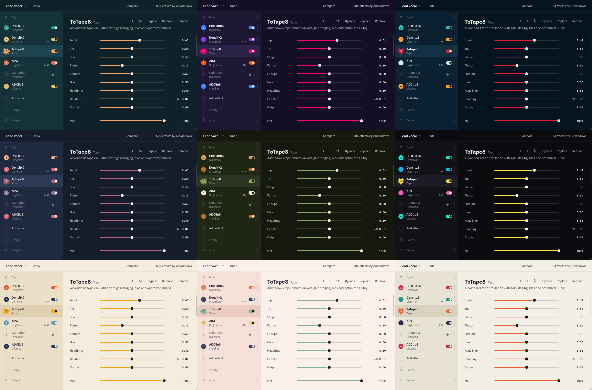
</p>
<p align="center"><sub>Nine colour themes. Each slot takes its own colour from the set.</sub></p>

<br>

<p align="center">
  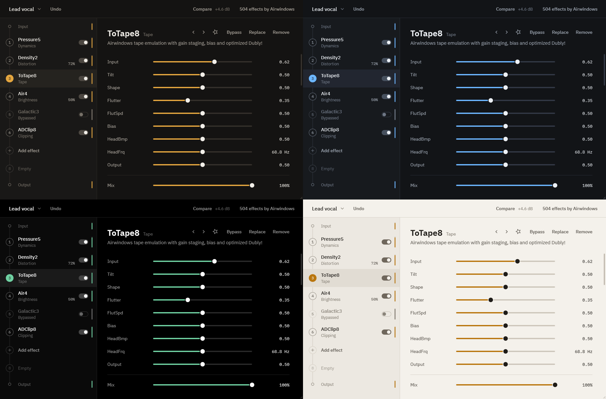
</p>
<p align="center"><sub>Or plain: Warm, Cool, Black and Light, each with six accents. Picked once, kept for every instance.</sub></p>

<br>

## Download

Windows, 64-bit: [latest release](https://github.com/clotheshoesandwoes/airwindows-chain/releases/latest).

- `AirwindowsChain-<version>-setup.exe` installs the VST3 and CLAP where every DAW looks, and the standalone app with a Start menu entry. It adds an uninstaller.
- `AirwindowsChain-<version>-windows.zip` if you'd rather copy the files yourself: the `.vst3` folder goes in `C:\Program Files\Common Files\VST3`, the `.clap` in `C:\Program Files\Common Files\CLAP`.

Windows warns that the publisher is unknown the first time; that is what an unsigned program from one person looks like. Then rescan plugins in your DAW once. It is listed under Kani. Ableton Live doesn't load CLAP plugins, so use the VST3 there.

<br>

## Using it

| Where | What |
|---|---|
| Chain list | Eight slots on show, more as they fill, up to sixteen. Click an empty one to add. Click to select. Drag to reorder. The switch bypasses. Double-click to replace. |
| Add effect | Opens the browser. Type to search names, categories and descriptions, Airwindows and your plugins together. Hover to read, click or Enter to add. Shift-click adds and keeps the browser open. Esc closes. |
| Your VST3 plugins | Every VST3 effect on the computer. The panel on the right lists its controls and the manual its maker installed. Scan again, and Folders to add or remove plugin folders and see what was skipped. |
| Open plugin window | On a plugin from your computer: its own interface, in a window of its own. |
| Compare | Plays the original at the chain's loudness. The number is how much louder the chain is. |
| Type to search | With the mouse over the window, type a letter and the browser opens with it. Keys the plugin doesn't use go to the host. Can be turned off in the chain menu. |
| For vocals | A switch at the top of the browser. On, every Airwindows list, the categories and search included, shows only the effects that suit a voice: compressors and gates, de-essers, air, channel strips, tape, plates and rooms, doublers. The list is mine, not Chris's, and lives in `src/VocalList.h`. |
| Effect panel | Drag a control, or click a fader's track to jump. Hold Ctrl or Shift while dragging for ten times finer moves. Double-click a control to reset it, or its value to type one. The arrows step through the effect's category. |
| Knobs | "Knobs instead of faders" in the chain menu lays the controls out as a grid of knobs. Drag up or right to raise. |
| Mix | Blends each effect with what went into it. |
| Meters | The small meter at the right edge of each effect is the level after it, from -60 dB to full scale. Red means it went over. Input and Output have one too. |
| Star | Marks a favourite. Favourites get their own list in the browser, first in line. |
| Right-click a row | Replace, duplicate, add an effect after this one, bypass, move, remove. |
| Undo | Next to the chain name after any edit. Covers add, remove, replace, move, duplicate, clear and open, forty steps deep. |
| Chain name | Save and open chains. They are small files in `Documents\Airwindows Chain`. Each saved chain in the menu shows the effects it holds, so you know what you are opening. Also holds Undo, the theme and accent choices, and About. |
| Theme | Nine colour themes, or Warm, Cool, Black and Light with an amber, coral, mint, sky, lilac or plain accent. Remembered for every instance. |

The host sees sixteen fixed blocks of parameters, named after whatever sits in each slot ("2. Density2: Drive"). Automation follows an effect when you reorder the chain.

<br>

## Build it yourself

```bat
tools\build.bat
tools\install.bat
```

`build.bat` needs Visual Studio 2022 with the C++ workload (it finds it through vswhere; CMake and Ninja come with it). The first build compiles all 504 effects and takes a few minutes. `install.bat` copies the result into the plugin folders; Windows asks for admin rights. `tools\package.py` makes the zip and the installer (the installer needs NSIS).

## Tests

`build\awchain_harness_artefacts\Release\awchain_harness.exe` runs everything headless:

| Command | Checks |
|---|---|
| `test` | The chain against the same effects run directly (bit-exact, including mix, bypass, reorder, 44.1/48/96 kHz, odd block sizes, mono). Compare's loudness match, to a tenth of a dB. Chains with effects that can't load, saved and reopened intact. Editing, state and chain files. Four seconds of random edits against a running audio thread. All 504 effects, at defaults and with every control at maximum. Every name on the vocals list exists. |
| `host <file.vst3>` | Hosts one of your plugins in the chain: its controls, audio through it, state round trip, a project naming another install folder, and (for Pro-Q 3) latency that changes with a preset, at 50% mix and bypassed. |
| `vst3 <path to .vst3>` | Loads the built plugin the way a DAW does: passthrough when empty, project state restore, processing, state save. |
| `snap <folder>` | Renders the editor to PNGs: main view, small and large windows, browser, search, the vocals switch, empty and full chains, every theme, About. |
| `readme <folder> [theme]` | Renders the pictures on this page at 2x, with the plugins installed on the computer it runs on. |
| `frames <folder> [seconds fps scale theme]` | Renders the editor frame by frame with audio running, for clips like the one at the top. |
| `dump <file.json>` | Every effect with its category, Chris's one line, its control names and his write-up, as JSON. The website's browser is built from it. |

## How it works

- `src/Catalog.*`: every effect in the registry, the search, the docs, and the vocals list.
- `src/ChainProcessor.*`: the chain. The message thread owns the model. The audio thread owns its own effect instances and hears about changes through a lock-free queue. Replaced instances go back through a second queue and are freed on the message thread, so nothing is allocated or freed while audio runs. Swapping, bypassing and removing fade over 20 ms.
- `src/Hosted.*`: plugins from the computer. The plugin list, the scan, control names and manuals, and the wrapper that runs a plugin where an Airwindows effect would sit, with its latency compensated.
- `src/Scanner.cpp`: the helper program that reads plugins out of process, so a crash while scanning never reaches the host.
- `src/Loudness.h`: K-weighted short-term loudness, as LUFS meters measure it, for Compare.
- `src/ChainEditor.cpp`, `src/ui/`: the interface. IBM Plex, drawn by hand, no images.

## Where it comes from

The effects are [Chris Johnson's](https://www.airwindows.com), from Airwindows. He publishes them as open source and writes up each one; those write-ups are what you read inside the plugin. [airwin2rack](https://github.com/baconpaul/airwin2rack), by BaconPaul and the Surge Synth Team, packaged every effect into one plugin, Consolidated, and built the registry this runs on. Airwindows Chain adds the chain, the browser and the interface, and leaves the audio code alone.

If you like the effects, [Chris's Patreon](https://www.patreon.com/airwindows) is what pays for them.

## Licence

The code in this repository is MIT: use it however you like. The effects (Airwindows, Chris Johnson) and the registry that packages them (airwin2rack, BaconPaul and the Surge Synth Team) are MIT as well.

The built plugin also contains JUCE and the VST3 SDK, which are GPLv3 for open-source projects. So the plugin you build or download is GPLv3: free to use and pass on, and anyone who ships it has to share the source too.

Fonts: IBM Plex Sans and Mono, SIL Open Font License (`resources/fonts/OFL.txt`). CLAP support: clap-juce-extensions, MIT. Plugin names and screenshots of their controls belong to their makers; they appear here only to show them running in the chain.
